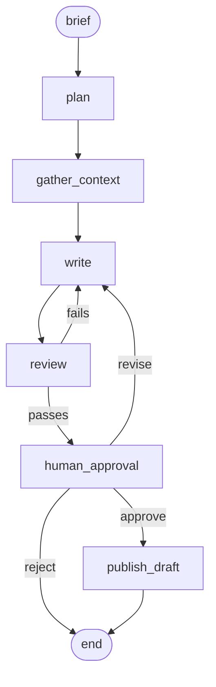

# wp-content-agent

A LangGraph agent that turns a content brief into a WordPress draft. It plans the post,
researches the sources and the site's existing posts, writes Gutenberg-ready HTML, reviews
it against a checklist, waits for a person to approve it, and then creates the post in
WordPress as a draft. It never publishes anything live.

WordPress is reached through `wp_mcp`, a small MCP server in this repo that wraps the REST
API. The agent loads its tools through an MCP client, so the same server also works on its
own from any MCP host.

I built it to practice the parts of an LLM project that usually get skipped: typed outputs,
a human in the loop, cost tracking per node, retries and timeouts, and tests that do not
need a model.

## How it works



`review` sends a failing draft back to `write` up to `MAX_REVISIONS` times (2 by default),
then hands it to a person either way. `gather_context` reads the site and `publish_draft`
creates the draft, both through the `wp_mcp` server, which calls the WordPress REST API.

| Node | What it does |
|---|---|
| `plan` | Turns the brief into an outline with sections and the points each one covers. |
| `gather_context` | A tool loop: fetches the brief's source URLs and searches the site's posts, then writes notes. Facts whose numbers do not appear on the fetched page are dropped. |
| `write` | Writes the post as plain semantic HTML with a title, slug, excerpt, meta description, categories from the site and tags. |
| `review` | Code checks (meta description length 140 to 160 characters, allowed HTML, numbers not found in the sources) plus a model checklist. Returns pass or fail and a fix for each failed check. |
| `human_approval` | A LangGraph `interrupt`. The CLI asks; the API returns `awaiting_approval` and waits for approve, reject or revise. A revise decision sends the draft back to `write` with the person's note, then through `review`, and stops here again. |
| `publish_draft` | Converts the HTML to Gutenberg blocks, creates missing tags and the post with status `draft`, and returns the edit URL. |

Every node appends its token use and cost to the run, and the state is checkpointed in
SQLite, so a run waiting for approval survives a restart.

## Quickstart

You need Docker, [uv](https://docs.astral.sh/uv/) and an Anthropic API key.

```bash
git clone https://github.com/reeenatamc/wp-content-agent
cd wp-content-agent
ANTHROPIC_API_KEY=sk-ant-... scripts/demo.sh
```

`scripts/demo.sh` starts a local WordPress with a few seeded posts, writes its connection
settings and your key into `.env`, and runs the example brief. The CLI prints each node as
it finishes with its tokens and cost, shows the draft and the review, and asks before
creating it. The run makes real model calls billed to your key, and the key stays
in `.env` (mode 600, ignored by git) for the later commands. Approve it and open the edit URL it prints (WordPress login `admin` / `admin`). If port
8080 is taken, run `WP_PORT=8088 scripts/demo.sh`.

After the first run, the pieces can be used one by one:

```bash
uv run wpagent run --brief examples/briefs/django-caching.yaml   # ask before creating
uv run wpagent run --brief my-brief.yaml --yes                  # approve if review passed
uv run wpagent status <run_id>
uv run wpagent approve <run_id> --note "looks good"
uv run wpagent reject <run_id>
uv run wpagent retry <run_id>                                   # run publish_draft again after it failed
uv run wpagent revise <run_id> --note "shorter intro"          # back to the writer
uv run wpagent serve                                            # HTTP API on :8000
```

A brief is YAML or JSON:

```yaml
topic: Caching Django querysets without serving stale data
audience: Backend developers who already use Django in production
tone: practical
target_words: 900
keywords: [django, caching, querysets]
source_urls:
  - https://docs.djangoproject.com/en/5.2/topics/cache/
```

To use OpenAI instead, set `LLM_PROVIDER=openai`, `OPENAI_API_KEY`, `WRITER_MODEL` and
`REVIEWER_MODEL` (there are no OpenAI defaults). Models, prices, timeouts, retries and
limits are all settings: `.env.example` lists the common ones and
[settings.py](src/wp_content_agent/settings.py) has the rest, such as `LLM_TIMEOUT_S`,
`LLM_MAX_RETRIES`, `MAX_TOOL_ITERATIONS` and `MODEL_PRICES`.

## HTTP API and n8n

`wpagent serve` starts a FastAPI app:

| Method | Path | |
|---|---|---|
| `POST` | `/runs` | Start a run from a brief. Returns `202` and the run id. An `Idempotency-Key` header makes retries safe. |
| `GET` | `/runs/{id}` | Status, the draft waiting for approval, review result, usage and cost. |
| `POST` | `/runs/{id}/approve` | Approve, with an optional note. The draft is created in the background. |
| `POST` | `/runs/{id}/reject` | Reject. Nothing is created. |
| `POST` | `/runs/{id}/retry` | Run `publish_draft` again for a run that failed there, using the approved draft. No model calls. |
| `POST` | `/runs/{id}/revise` | Send the draft back to the writer. Body: `{"note": "..."}`, 1 to 2000 characters, required. The run writes, reviews and waits for approval again. `409` when no human revisions are left. |
| `POST` | `/webhooks/n8n` | Same as `POST /runs`, authenticated with `X-Webhook-Secret`. |

The `/runs` endpoints take `Authorization: Bearer $API_TOKEN` when `API_TOKEN` is set, and
the server refuses to listen beyond localhost without it. The webhook is off until
`WEBHOOK_SECRET` is set.

[examples/n8n](examples/n8n) has a workflow that takes a brief from an n8n form, starts a
run through the webhook and polls it until it waits for approval.

## The MCP server on its own

`wp_mcp` exposes six tools over stdio: `list_posts`, `get_post`, `list_categories`,
`list_tags`, `create_tag` and `create_draft_post`. There is no tool that publishes or
deletes, and `create_draft_post` always sends `status: draft`.

```bash
WP_BASE_URL=http://localhost:8080 WP_USERNAME=admin WP_APP_PASSWORD=... uv run wp-mcp
```

To add it to Claude Desktop or another MCP host:

```json
{
  "mcpServers": {
    "wordpress": {
      "command": "uv",
      "args": ["--directory", "/path/to/wp-content-agent", "run", "wp-mcp"],
      "env": {
        "WP_BASE_URL": "http://localhost:8080",
        "WP_USERNAME": "admin",
        "WP_APP_PASSWORD": "xxxx xxxx xxxx xxxx xxxx xxxx"
      }
    }
  }
}
```

[docs/mcp-server.md](docs/mcp-server.md) covers the tools, their limits and the retry
behavior.

## Design decisions

- The model writes plain HTML and code converts it to Gutenberg blocks. Models are better
  at HTML than at block comments, the review checks are simpler on HTML, and the converter
  is tested on its own.
- Grounding is enforced in code, not only in prompts. Notes keep only facts whose numbers
  appear on the fetched page, related posts must come from WordPress tool results, and the
  review fails any number in the draft that is not in the sources.
- Two models: Sonnet writes and Haiku reviews. The review is mostly a checklist, so a
  smaller model does it for a fraction of the cost.
- Approval is a graph interrupt with a SQLite checkpointer rather than a flag in a
  database. A run can wait for days and be resumed from the CLI or the API, and a crashed
  run is marked failed instead of staying half done.
- The MCP server has no publish or delete tool, so "drafts only" does not depend on the
  model behaving. `publish_draft` also checks the status WordPress returns.
- Prompt caching marks every system prompt, plus the brief and notes in `write` and
  `review`, which run again on every revision. The eval table reports how much of the
  input came from cache.

[docs/architecture.md](docs/architecture.md) goes deeper into the state, the error
handling and the API.

## Evals

`evals/run.py` runs five briefs through the graph up to human approval, so nothing is
created in WordPress, and writes [evals/results.md](evals/results.md) with the review
result, revisions, tokens, cache reads and cost of each one. One brief has no sources, to
check that the writer stays general instead of inventing numbers.

```bash
uv run python evals/run.py
```

No results are committed yet. The table is written only by a real run with an API key,
and I would rather leave it out than show numbers I did not measure.

## Development

```bash
uv sync
uv run pytest            # unit tests, no network or API key
uv run ruff check . && uv run ruff format --check . && uv run mypy src evals
WPAGENT_INTEGRATION=1 uv run pytest tests/integration   # needs scripts/wp-up.sh first
```

Unit tests fake the models and WordPress. The integration tests run the MCP server against
the Docker WordPress and drive the whole graph with scripted models. CI runs ruff, mypy in
strict mode and pytest on every push.

## Limitations

- Rejecting a draft ends the run. To change a draft instead, use revise; each run allows
  `MAX_HUMAN_REVISIONS` of them (2 by default), and each one can cost up to
  `MAX_REVISIONS + 1` more writes, because the review loop runs again after the note.
- Only a run that failed inside `publish_draft` can be retried; other failures need a
  new run. If the failed request timed out, WordPress may have created the post anyway,
  so check the site before retrying.
- If the process dies after WordPress creates the post but before the checkpoint is
  written, resuming creates a second draft.
- The Gutenberg converter is tested against the block grammar, not against the editor
  itself, so an unusual structure may open as a Custom HTML block.
- If the site has more categories or tags than `WP_MAX_TERM_PAGES` allows, the list is
  truncated and that only shows in the log.
- Prompt caching does nothing when a prompt is shorter than the provider's minimum
  cacheable length, which is the case for short briefs.
- The per-run lock that stops two approvals at once works inside one process. Running
  several API workers on the same checkpoint file is not supported.
- `status`, `approve`, `reject`, `revise` and `retry` load the full configuration,
  including the model key, even though they do not call a model.
- Number checks catch invented statistics, not invented claims without numbers; that part
  rests on the model reviewer.

## License

MIT. See [LICENSE](LICENSE).
